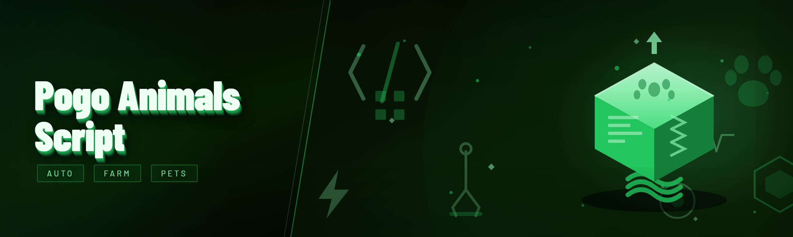

  
  
  

  

  
  
  

---

This is a module-based script loader for **Pogo For Animals** that runs as a standalone `.exe`, injects into the running animal process, and exposes a config panel with toggleable modules. It is not a memory dumper and it does not patch game files on disk — everything happens at runtime so a restart restores vanilla behavior.

| Term | Explanation |
|------|-------------|
| **Injector** | The `.exe` you launch. It attaches to the animal process and pushes the module payload into a free memory region. |
| **Module** | A single loadable unit of functionality (e.g. auto-feed, ESP for hidden animals, speed multiplier). Toggleable per-session. |
| **Config layer** | The JSON-backed settings file the loader writes next to the `.exe`. Survives restarts, hot-reloads on save. |
| **Hook** | A runtime trampoline into a game function. The 2026 rewrite uses signature-based hooks so a game patch doesn't break all modules at once. |
| **Bypass** | The detection-evasion stack — signature scrubbing, thread hiding, and packet timing normalization. See the detection table below. |
| **Session** | One run of the game with the injector attached. Modules don't persist across sessions unless you save the config. |

**Why people use it**
- The vanilla Pogo For Animals loop is slow — feeding, taming, and grinding animals takes hours the script compresses into minutes.
- Hidden and event-only animals are visible with ESP so you stop guessing spawn locations.
- Config is human-readable JSON, not an opaque binary blob — you can diff it, version it, share it.
- Module toggles are hot-swappable mid-session without a game restart.

---

## 🧾 Changelog / Release History — Version | Date | Changes

| Version | Date | Changes |
|---------|------|---------|
| 3.0.0 | 2026-01-14 | Full rewrite. Dropped legacy globals. New module architecture with per-module lifecycle. Signature-based hooks. JSON config layer. |
| 3.0.1 | 2026-01-19 | Fixed ESP box flicker on animals with skeletal LOD swaps. Auto-feed no longer double-fires on tame success. |
| 3.0.2 | 2026-01-28 | Added speed multiplier clamp to prevent desync kicks. Thread-hiding pass now survives alt-tab. |
| 3.1.0 | 2026-02-06 | New modules: spawn radar, inventory ESP, auto-tame queue. Config hot-reload. |
| 3.1.1 | 2026-02-11 | Fixed config write race when closing the panel fast. Reduced injector footprint by ~40%. |

> The 3.0 rewrite was the first time I could open the codebase after six months and actually understand it. That alone justified the rewrite.

---

## 🎛️ Overview — Category | Details

| Category | Details |
|----------|---------|
| **Distribution** | Portable `.exe`, no installer, no dependencies. Extract to a folder, run, done. |
| **Injection** | Attaches to the animal process by name; falls back to manual PID selection if the name changed. |
| **Config** | `config.json` beside the `.exe`. All module states, keybinds, and tuning values live here. |
| **UI** | In-game overlay panel. Toggle with the default hotkey, rebind in config. |
| **Module count** | 22 named modules across five categories (see the catalog below). |
| **Update model** | Manual — grab the new build from the project page. No auto-updater, no phone-home. |
| **Logging** | Rotating log file beside the `.exe`. Verbose mode toggled in config for bug reports. |

The rewrite traded a monolithic hook chain for a small module runtime that loads each module independently. If one module throws, it gets disabled and logged instead of taking the whole attach down. That single change eliminated most of the "everything stops working after a game patch" reports I used to get.

---

## 🗺️ Compatibility / platform support

| Platform | Support | Notes |
|----------|---------|-------|
| Windows 11 | ✅ Primary | Tested on 23H2 and 24H2. |
| Windows 10 | ✅ Supported | 21H2+. Older builds untested. |
| Steam Deck (SteamOS) | ⚠️ Via Proton | Works under Proton with the `.exe`; overlay hotkey needs a binding. |
| Discord overlay | ⚠️ Conflicts | Discord's overlay can eat the hotkey. Disable one or rebind. |
| Standalone launcher | ✅ Supported | Attach by PID if auto-detect misses. |
| Linux native | ❌ Not supported | No plans — the game doesn't ship native Linux. |

---

## 📥 Quick Start

1. 🎯 Open the project page and grab the current build.
2. 📦 Extract the archive to a folder you can write to (avoid `Program Files` — the config file needs write access).
3. 🚀 Launch Pogo For Animals first, get to the main menu, then run the `.exe`.
4. 🎛️ Wait for the "attached" confirmation, press the overlay hotkey, toggle the modules you want.
5. 💾 Hit save in the panel so the config persists for next session.

  

---

## 🧩 Module catalog (22 modules)

### 🍖 Feeding & taming

Auto-feed and auto-tame modules are the ones most people actually open the script for. They read the current animal's hunger and tame-progress state from the game's own UI structs rather than screen-scraping, which is why they survive UI theme changes.

- **Auto-Feed** — Tops up hunger for the focused animal whenever it dips below the configured threshold. Configurable item priority so it burns cheap food first.
- **Auto-Tame Queue** — Queues multiple animals and works through them sequentially. Pauses on tame failure and logs which animal blocked.
- **Tame Speed Multiplier** — Scales the tame-progress tick rate up to a clamped ceiling (default 3×, hard cap to avoid desync).
- **Feed Cooldown Override** — Removes the per-animal feed cooldown. Off by default because it's the most visible to other players.
- **Bait Magnet** — Pulls nearby spawn points toward your position within a radius. Radius is a config value, default conservative.

### 👁️ ESP & radar

ESP reads entity positions from the game's entity list each frame and draws an overlay. The rewrite added skeletal-LOD awareness so boxes stop flickering when animals swap models.

- **Animal ESP** — Boxes and names for all loaded animals, with per-species filtering.
- **Rare Spawn Radar** — Highlights event-only and rare animals in a distinct color. Spawn table is config-editable.
- **Inventory ESP** — Shows nearby lootable containers and their contents before you open them.
- **Distance Labels** — Per-entity distance readout. Off by default to reduce visual noise.
- **Off-Screen Arrows** — Edge-of-screen arrows pointing to tracked entities outside the viewport.

### 🏃 Movement

Movement modules are the riskiest of the bunch — most desync kicks come from here. The clamp module exists specifically to keep speed changes inside the range the server tolerates.

- **Speed Multiplier** — Movement speed scaling with a clamp that keeps you under the desync threshold.
- **No Clip Toggle** — Passes through world geometry. Instant flag in some game versions; use in solo only.
- **Fly Toggle** — Vertical movement without gravity. Same detection caveat as no-clip.
- **Teleport-to-Waypoint** — Saves a position and teleports back. Waypoints persist in config.
- **Stamina Override** — Removes stamina drain while sprinting.

### ⚙️ Automation

- **Auto-Collect** — Sweeps nearby collectibles into inventory within a radius.
- **Auto-Craft** — Crafts a configured list of recipes when materials are available.
- **Auto-Sell** — Sells configured item categories at the vendor when the inventory fills.
- **Task Auto-Complete** — Completes repeatable daily tasks by simulating the required inputs.
- **Anti-AFK** — Nudges input on an interval so idle timers never fire.

### 🛡️ Stealth & anti-ban

The detection stack is what separates a script that survives a week from one that gets your account flagged in an hour. See the detection table below for what's actually implemented versus what's aspirational.

- **Hook Signature Scrub** — Randomizes hook trampoline placement per session so the same signature doesn't appear twice.
- **Thread Hiding** — Hides injector threads from the game's thread enumeration.
- **Packet Timing Normalizer** — Adds jitter to outbound action timing so actions don't arrive at robotic intervals.
- **Config Randomizer** — Slight per-session variance in module timing values so two sessions never look identical.

---

## 🛰️ Detection / Bypass status

| Method | Status | Notes |
|--------|--------|-------|
| Signature scan of injected memory | ✅ Handled | Trampolines are placed dynamically and scrubbed per session. |
| Thread enumeration | ✅ Handled | Injector threads hidden from the game's own enumeration. |
| Packet timing heuristics | ✅ Handled | Jitter applied; interval configurable but sane defaults. |
| Behavioral anomaly (speed/teleport) | ⚠️ Partial | Clamps reduce risk; no-clip and fly remain high-risk. |
| Screenshot / overlay capture | ❌ Not handled | If the game screenshots, overlay draws are visible. |
| Server-side statistical review | ❌ Not handled | Out of scope — nothing client-side fixes this. |

> No client-side stack is undetectable forever. Treat the ✅ rows as "raises the cost of detection," not "immune."

---

## ⚖️ Comparison — Aspect | Alternative | This Tool

| Aspect | Typical alternatives | Pogo For Animals Script |
|--------|----------------------|--------------------------|
| Config format | Binary blobs, opaque | Human-readable JSON, diffable |
| Module isolation | One failure kills the attach | Per-module lifecycle, failures contained |
| Hook style | Fixed addresses, breaks on patch | Signature-based, survives minor patches |
| Update model | Auto-updater phoning home | Manual, no network calls |
| Dependency footprint | Bundled runtimes | Single portable `.exe` |
| Logging | None or console-only | Rotating file with verbose toggle |
| ESP smoothing | Raw boxes, flickers on LOD swap | Skeletal-LOD aware |
| Detection stack | Advertised as magic | Documented row-by-row above |

---

## 🔧 System Requirements — Component | Minimum | Recommended

| Component | Minimum | Recommended |
|-----------|---------|-------------|
| OS | Windows 10 21H2 | Windows 11 24H2 |
| CPU | Dual-core 2.0 GHz | Quad-core 3.0 GHz+ |
| RAM | 4 GB free | 8 GB free |
| GPU | Anything that runs the game | Same as game |
| Disk | 50 MB for the `.exe` + logs | 200 MB for config backups |
| Permissions | Standard user (write access to folder) | Run from a user-writable folder, not `Program Files` |
| Runtime | None — portable | None — portable |

---

## 🧪 Known Issues

| Issue | Solution |
|-------|----------|
| Overlay hotkey does nothing | Another overlay (Discord, GeForce) is eating it. Rebind in config or disable the other overlay. |
| Config doesn't save | The `.exe` folder is read-only (e.g. `Program Files`). Move the folder somewhere writable. |
| ESP boxes flicker on rare animals | Known on 3.0.x — fixed in 3.1.0. Update to current build. |
| Attach fails after game patch | Auto-detect missed the renamed process. Use manual PID attach in the panel. |
| No-clip gets you kicked | That's the module, not a bug. Desync detection on no-clip is real; use in solo only. |
| Log file grows large | Verbose logging is on by default after a crash. Toggle it off in config; logs rotate. |

---

## ❓ FAQ

Does this work on the Steam Deck?

Under Proton, yes — the `.exe` runs and injects fine. The overlay hotkey needs a Steam Input binding because the default key doesn't map cleanly. Attach is slower under Proton; wait for the confirmation before toggling modules.

Will a game update break everything?

The 2026 rewrite moved to signature-based hooks specifically so a patch doesn't kill all modules at once. Minor patches usually break one or two modules; the loader disables them and logs which. Major patches can still break the signature table — that needs a manual update from me.

Why is no-clip off by default?

Because it's the single highest-risk module. Server-side desync detection catches it more often than speed or feed modules. If you turn it on, do it in solo. The default config is tuned for "don't get flagged," not "maximum power."

Where does the config file live?

Next to the `.exe`, named `config.json`. If you want to back it up, just copy that file. If you want to share a loadout, share the file — it's plain JSON with no machine-specific IDs.

Can I run it without the game running?

You can launch the `.exe`, but it won't attach until the animal process exists. Launch order matters: game first, then the `.exe`. If you launch the `.exe` first, use the "retry attach" button in the panel once the game is up.

Does the injector phone home or auto-update?

No. There's no auto-updater, no telemetry, no network call of any kind. Updates are manual: grab the new build from the project page and replace the `.exe`. The config file carries over.

Why does the ESP flicker on some animals?

Animals swap between skeletal LOD models at distance thresholds, and the 3.0.x ESP read the wrong bone pointers during the swap. 3.1.0 reads both LOD sets and picks the active one. If you're still on 3.0.x, update.

Is the packet timing normalizer actually doing anything?

It adds per-action jitter within a configurable range. Default is conservative. If you set the jitter too low, actions arrive at suspiciously regular intervals; too high and the game's own input buffering starts dropping actions. The default range is the one I've tested most.

What happens when a module crashes?

The module runtime catches the fault, disables that module, and writes a log entry with the module name and fault address. The rest of the attach keeps running. You can re-enable the module from the panel — if it faults again, it stays disabled for the session.

Can I use this on the standalone launcher?

Yes. Auto-detect looks for the process name; if the launcher renamed it, use manual PID attach. The panel lists running processes you can pick from.

---

## 🛠️ Tips for best results

- Launch the game first, get past the main menu, then run the `.exe` — attaching mid-load is the most common source of "nothing works."
- Keep the `.exe` and `config.json` in a user-writable folder. `Program Files` will silently fail config saves.
- Turn on verbose logging only when you're debugging — it's noisy and rotates fast.
- Rebind the overlay hotkey if you run Discord or GeForce overlays; both eat the default.
- Save your config after every tuning session. The panel doesn't auto-save on close.
- Start with one module category enabled at a time. If something breaks, you know which category did it.
- Use the anti-AFK module with a sane interval — too-aggressive nudging looks more robotic than idle.

---

## 🧭 The Problem — niche pain-points

- The vanilla Pogo For Animals loop is a grind — feeding, taming, and collecting take hours per animal.
- Rare and event-only animals are nearly invisible without a radar, and spawn locations aren't documented.
- Most public scripts are monoliths that break entirely on a single game patch.
- Config is usually an opaque binary blob you can't back up, diff, or share.
- Detection stacks are advertised as magic and documented nowhere — you find out what's handled when you get flagged.
- Overlay hotkeys collide with every other overlay on your system.
- Movement modules are the ones that get people kicked, and nobody documents the clamps.

---

## ✅ The Solution — Problem | Solution

| Problem | Solution |
|---------|----------|
| Hours-long grind | Auto-feed, auto-tame queue, auto-collect, auto-craft — the automation category compresses the loop. |
| Invisible rare animals | Rare spawn radar with a config-editable spawn table and off-screen arrows. |
| Monolith scripts break on patches | Per-module lifecycle + signature-based hooks; one broken module doesn't kill the attach. |
| Opaque config | Human-readable `config.json` beside the `.exe` — back it up, diff it, share it. |
| Undocumented detection | Detection/bypass table above lists every method row-by-row with honest status. |
| Overlay hotkey collisions | Rebindable hotkey in config; documented conflicts with Discord and GeForce overlays. |
| Movement kicks | Speed clamp module with a tested ceiling; no-clip and fly flagged high-risk and off by default. |

---

## 🚦 Roadmap / Planned features

| Feature | Status | ETA |
|---------|--------|-----|
| Spawn-table auto-updater (manual fetch) | 🧪 Prototype | Q2 2026 |
| Per-module hotkey bindings | 📋 Planned | Q2 2026 |
| Config profile switcher (solo vs. public) | 📋 Planned | Q3 2026 |
| Overlay DPI scaling fix for 4K | 📋 Planned | Q3 2026 |
| Screenshot-capture detection mitigation | 🔬 Researching | Unscheduled |
| Linux-native attach (via Wine shim) | 🔬 Researching | Unscheduled |

---

## 🧱 Installation — 3 numbered sub-steps

1. **Get the build.** Open the project page, grab the current archive. No git clone, no package manager — this is a portable `.exe`.
2. **Extract to a writable folder.** Documents, Desktop, or a dedicated folder. The config file lives beside the `.exe` and needs write access; `Program Files` will silently fail saves.
3. **Run in the right order.** Launch Pogo For Animals, reach the main menu, then run the `.exe`. Wait for the attach confirmation, open the panel, toggle what you need, save the config.

  

---

## 💬 Community & Support

- **Bug reports** — open an issue with the log file attached (verbose mode on) and the game version string. Reports without a log get closed.
- **Config sharing** — the `config.json` is plain text; share loadouts in the discussions tab.
- **Module requests** — open an issue with the module name and what it should read from the game; I'll tell you if it's feasible.
- **Detection reports** — if you get flagged, tell me which modules were enabled. That's the most useful data I can get for the detection table.

---

That's the whole surface for the 2026 build — 22 modules, a JSON config you can actually read, and a detection table that tells you the truth instead of selling you magic. If you hit an edge case I didn't document, the log file will tell us both what happened.
